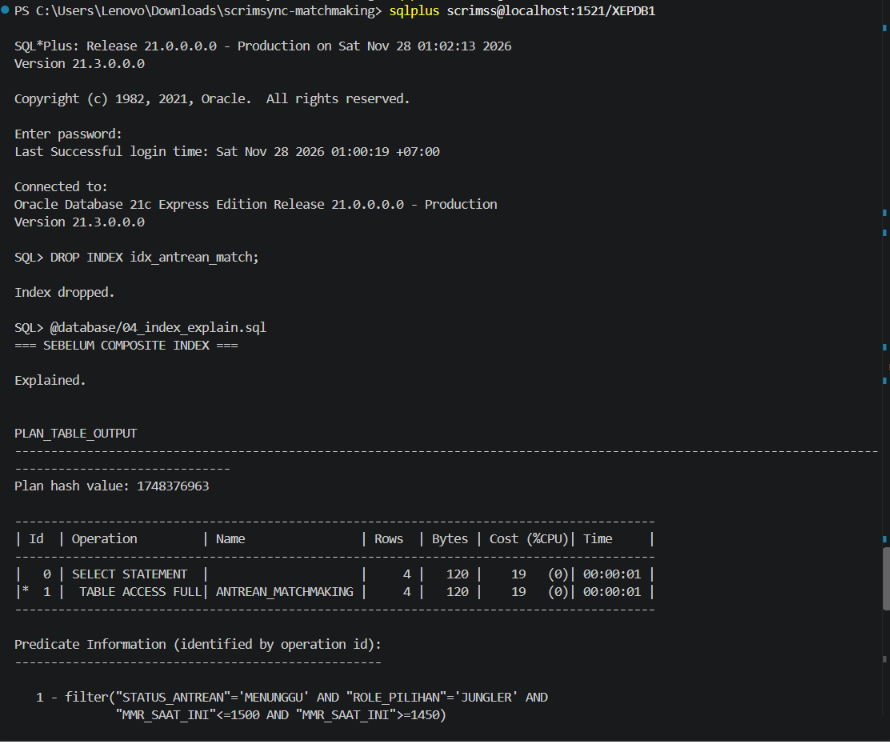
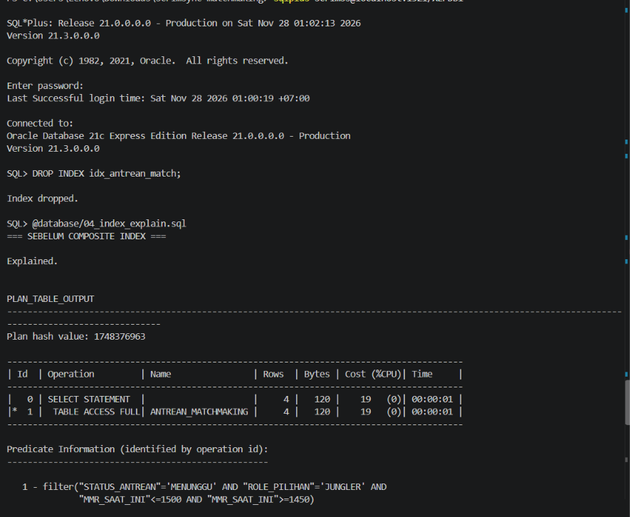

# ScrimSync - Competitive Esports Matchmaking & Scrim Manager

Platform competitive matchmaking, party finder, dan manajemen latih tanding (scrim) berbasis Skill Rating (MMR) menggunakan React, Express, dan Oracle Database XE 21c.

---

## 1. Tim Pengembang & Pembagian Peran

| Nama Anggota | NPM | Peran Utama | Tanggung Jawab Teknis |
| :--- | :--- | :--- | :--- |
| **Azmi Basri** | `250810701100044` | Database & PL/SQL Lead | Desain 8 tabel relasional (Oracle XE 21c), 1.000+ *seed data*, *Stored Procedure*, *Trigger*, *View*, dan optimasi *Composite Index* (`EXPLAIN PLAN`). |
| **Erdian Wijaya** | `250810701100068` | Backend & Concurrency Lead | REST API Node.js + Express (`node-oracledb` mode Thin), *connection pooling*, transaksi manual (`COMMIT`/`ROLLBACK`), `SELECT ... FOR UPDATE`, dan *bind variable*. |
| **Moula Zaki** | `250810701100083` | Frontend & Docs Lead | Antarmuka React (Vite) + Tailwind CSS (4 halaman terintegrasi API), penanganan error HTTP (`400`/`403`/`404`/`409`/`503`), `README.md`, PDF Studi Kasus, dan Video Demo. |

---

## 2. Diagram ERD, Bukti EXPLAIN PLAN & Screenshot Demo

### Entity Relationship Diagram (ERD 8 Tabel) & Optimasi Index
| Artefak Database | Preview | Keterangan |
| :--- | :--- | :--- |
| **ERD 8 Tabel Relasional** |  | Relasi `Pengguna`, `Profil_Game_Role`, `Antrean_Matchmaking`, `Sesi_Pertandingan`, `Partisipan_Match`, `Laporan_Skor`, `Riwayat_MMR`, dan `Log_Penalti`. |
| **EXPLAIN PLAN Sebelum Index** |  | Eksekusi kueri pencarian antrean menggunakan `TABLE ACCESS FULL` pada 1.000+ baris data. |
| **EXPLAIN PLAN Sesudah Composite Index** |  | Eksekusi berubah menjadi `INDEX RANGE SCAN` setelah pembuatan *Composite Index* `(status_antrean, role_pilihan, mmr_saat_ini)`. |

### Screenshot Antarmuka & Bukti Fullstack DevTools
> *Simpan hasil tangkapan layar aplikasi dan bukti DevTools Network di folder `docs/screenshots/`.*

| Halaman UI | Preview Tampilan | Keterangan Teknis |
| :--- | :--- | :--- |
| **1. Matchmaking & Antrean** | `` | Pemilihan *role* utama, antrean berbasis MMR, blokir *cooldown* (`HTTP 403`), dan pemicu `sp_pasangkan_match`. |
| **2. Lobby & Ready Check** | `` | Roster 5v5 (Tim Alpha vs Beta), hitung mundur `batas_ready_check`, tombol *Accept*/*Decline*, dan pemicu *timeout*. |
| **3. Laporan Skor & Admin** | `` | Unggah bukti skor oleh kapten dan verifikasi *dispute* Admin yang mengeksekusi `sp_update_mmr` secara atomik. |
| **4. Real-Time Leaderboard** | `` | Peringkat MMR terkini dari Oracle View `v_leaderboard_mmr` dengan filter *role* dan statistik *win rate*. |
| **5. Bukti Fullstack DevTools** | `` | Tab *Network (Fetch/XHR)* memperlihatkan status `200 OK` / `201 Created` dari Express + Oracle XE 21c. |

---

## 3. Tautan Demo & Video Presentasi

* **Repositori GitHub:** [https://github.com/Azmibasri/scrimsync-matchmaking](https://github.com/Azmibasri/scrimsync-matchmaking)
* **Video Presentasi & Demo Fullstack (YouTube):** `[Tautan Video YouTube Unlisted/Public — Maks. 10 Menit]`

---

## 4. Masalah yang Diselesaikan

Pencarian rekan tim (*party*) dan lawan latih tanding (*scrim*) di lingkungan kampus selama ini masih mengandalkan *broadcast* manual di grup WhatsApp atau Discord. Pola tersebut menimbulkan empat masalah utama:
1. **Ketimpangan Skill (MMR Mismatch):** Pertandingan sering tidak seimbang karena tidak ada penyaringan rentang peringkat dan komposisi *role*.
2. **Race-Condition & Klaim Slot Ganda:** Pada sistem CRUD sederhana, ketika banyak pemain menekan tombol *Find Match* atau merebut sisa 1 slot *role* pada milidetik yang sama, terjadi *over-capacity* lobi atau satu pemain masuk ke dua sesi sekaligus.
3. **Ghosting / Dodge Tanpa Sanksi:** Pemain yang membatalkan pertandingan saat lobi sudah terbentuk menyebabkan tim lain menunggu tanpa kejelasan.
4. **Sengketa Skor & Inkonsistensi Leaderboard:** Perubahan poin peringkat 10 pemain berisiko rusak apabila salah satu kueri gagal di tengah proses tanpa mekanisme transaksi atomik.

---

## 5. Fitur Utama Aplikasi

1. **Smart Queue & Role-Based Matchmaking:** Pendaftaran antrean berdasarkan 5 *role* spesifik (`JUNGLER`, `ROAMER`, `MID_LANER`, `GOLD_LANER`, `EXP_LANER`) dengan penguncian baris (`SELECT ... FOR UPDATE`) melalui prosedur `sp_pasangkan_match`.
2. **Real-Time Ready Check & Timeout Handler:** Fase konfirmasi 5v5 berbatas waktu (`batas_ready_check`) dengan pembubaran lobi otomatis apabila ada pemain menolak atau melewati batas waktu konfirmasi.
3. **Sistem Anti-Dodge & Penalty Cooldown Otomatis:** *Trigger* database otomatis mencatat pelanggaran ke `Log_Penalti` dan mengunci akun pemain (`cooldown_hingga`) sehingga request antrean baru ditolak dengan `HTTP 403 Forbidden`.
4. **Laporan Skor Kapten & Verifikasi Dispute Admin:** Kapten mengunggah tautan bukti hasil pertandingan (`Laporan_Skor`), kemudian Admin memverifikasi laporan untuk memicu kalkulasi MMR seluruh partisipan secara atomik (`sp_update_mmr`).
5. **Real-Time MMR Leaderboard & Immutable Audit Log:** Peringkat pemain disajikan langsung dari View `v_leaderboard_mmr`, sementara tabel histori `Riwayat_MMR` dan `Log_Penalti` diproteksi oleh *Trigger* agar tidak dapat diubah maupun dihapus (`BLOCK UPDATE/DELETE`).

---

## 6. Tech Stack & Alasan Pemilihan Teknologi

| Lapisan | Teknologi | Alasan Pemilihan |
| :--- | :--- | :--- |
| **Database** | **Oracle Database XE 21c** | Mendukung penuh fitur Basis Data Lanjut: transaksi manual (`COMMIT`/`ROLLBACK`/`SAVEPOINT`), *row-level locking* (`SELECT ... FOR UPDATE`), PL/SQL *Stored Procedure*, *Trigger*, *View*, serta analisis `EXPLAIN PLAN` dengan *Composite Index*. |
| **Backend** | **Node.js & Express.js (`node-oracledb`)** | Arsitektur *asynchronous non-blocking* tangguh menangani *request* konkuren saat *matchmaking*. Driver `node-oracledb` mode **Thin** berjalan tanpa instalasi Oracle Instant Client tambahan dan mendukung *bind variable* (`:param`) untuk mencegah *SQL Injection*. |
| **Frontend** | **React.js (Vite) & Tailwind CSS** | Membangun antarmuka *Single Page Application* yang responsif, terhubung langsung ke REST API Express menggunakan `fetch()`, serta memetakan status HTTP (`200`, `201`, `400`, `403`, `404`, `409`, `503`) secara informatif. |
| **Tools** | **DBeaver, Postman & Git/GitHub** | Pengujian skrip PL/SQL, simulasi uji *concurrency* multi-request pada REST API, dan kolaborasi kode berbasis *branch* dan *Pull Request*. |

---

## 7. Diagram Arsitektur 3 Lapis (3-Tier Architecture)

```text
+-----------------------------------------------------------------------------------+
|                        LAPISAN PRESENTASI (FRONTEND)                              |
|  React.js (Vite) + Tailwind CSS  [Port 5173]                                      |
|  • MatchmakingPage  • LobbyReadyPage  • ReportAdminPage  • LeaderboardPage        |
+-----------------------------------------+-----------------------------------------+
                                          | REST API (JSON via HTTP fetch + CORS)
                                          v
+-----------------------------------------------------------------------------------+
|                        LAPISAN APLIKASI (BACKEND)                                 |
|  Node.js + Express.js + node-oracledb (Thin Mode)  [Port 3000]                    |
|  • Connection Pool   • Bind Variables (:param)   • Error Mapper (kirimError)      |
|  • Manual Transaction Control (autoCommit: false -> COMMIT / ROLLBACK)            |
+-----------------------------------------+-----------------------------------------+
                                          | TCP / Oracle Net Protocol [Port 1521]
                                          v
+-----------------------------------------------------------------------------------+
|                        LAPISAN DATA (ORACLE DATABASE XE 21c)                      |
|  • 8 Tabel Relasional (Pengguna, Profil_Game_Role, Antrean_Matchmaking,           |
|    Sesi_Pertandingan, Partisipan_Match, Laporan_Skor, Riwayat_MMR, Log_Penalti)   |
|  • PL/SQL: sp_pasangkan_match, sp_update_mmr, Auto-Penalty & Audit Triggers       |
|  • Views: v_leaderboard_mmr, v_lobby_aktif  | Index: idx_antrean_match            |
+-----------------------------------------------------------------------------------+
```

---

## 8. Prasyarat, Langkah Instalasi & `.env.example`

### Prasyarat Sistem
* **Oracle Database XE 21c** (aktif pada `localhost:1521` dengan *service name* `XEPDB1`) dan **DBeaver** / SQL*Plus.
* **Node.js v18+** (LTS) dan **npm**.
* **Git**.

### Langkah 1: Setup Database (Oracle XE 21c)
Jalankan 4 skrip SQL di folder `database/` secara berurutan melalui DBeaver:
1. `database/01_schema.sql` — Membuat 8 tabel relasional beserta `PK`, `FK`, `UNIQUE`, dan `CHECK` *constraint*.
2. `database/02_seed_1000.sql` — Mengisi data awal pengguna dan 1.000+ baris uji pada `Antrean_Matchmaking`.
3. `database/03_views_procedures_triggers.sql` — Mengompilasi `v_leaderboard_mmr`, `v_lobby_aktif`, `sp_pasangkan_match`, `sp_update_mmr`, dan seluruh *Trigger*.
4. `database/04_index_explain.sql` — Membuat *Composite Index* dan menguji `EXPLAIN PLAN`.

### Langkah 2: Setup Backend (`backend/`)
```bash
cd backend
npm install
cp .env.example .env
# Sesuaikan isi backend/.env dengan kredensial Oracle lokal Anda
node cek-koneksi.js
node server.js
```

**Contoh Konfigurasi `backend/.env.example`:**
```env
PORT=3000
DB_USER=scrimsync_user
DB_PASSWORD=ganti_dengan_password_lokal_anda
DB_CONNECT_STRING=localhost:1521/XEPDB1
```

### Langkah 3: Setup Frontend (`frontend/`)
```bash
cd frontend
npm install
npm run dev
```
Buka `http://localhost:5173` di browser. Pastikan sakelar mode di kanan atas diatur ke **`Mode: LIVE API (:3000)`** (atau ubah `USE_MOCK = false` pada `frontend/src/config/api.js`).

---

## 9. Tantangan Teknis & Roadmap Pengembangan

### Tantangan Teknis yang Diselesaikan
* **Sinkronisasi Penamaan Kolom JSON:** Oracle secara bawaan mengembalikan nama kolom dalam huruf kapital (`ID_SESI`). Kendala ini diselesaikan dengan memberikan alias berkutip ganda (`AS "id_sesi"`) di seluruh kueri *backend* agar kontrak data JSON dengan React konsisten menggunakan *lowercase*.
* **Simulasi Timer Ready Check di Oracle:** Karena *Trigger* Oracle berbasis *event* DML dan tidak berjalan otomatis berdasarkan waktu berjalan, *backend* menyediakan endpoint `POST /api/matches/:id/timeout-check` untuk mendeteksi `SYSDATE > batas_ready_check` dan memicu *Trigger* penalti di database.
* **Isolasi Kunci Baris saat Concurrency:** Pengujian 5 *request* serentak pada 1 slot tersisa berhasil diamankan dengan `SELECT ... FOR UPDATE` sehingga hanya 1 transaksi yang melakukan `COMMIT` (`HTTP 200`) sementara sisanya diarahkan ke `ROLLBACK` (`HTTP 409`).

### Roadmap Pengembangan Selanjutnya
* Integrasi WebSocket (`Socket.io`) untuk *push notification* real-time saat *Ready Check* muncul tanpa *polling* manual.
* Penambahan autentikasi berbasis JWT (*JSON Web Token*) dan validasi verifikasi KTM/email kampus `@mhs.usk.ac.id`.
* Sistem turnamen *bracket* antar-fakultas dan integrasi statistik pasca-pertandingan otomatis.

---

## 10. Pernyataan Penggunaan AI (Transparansi Akademik)

Sesuai pedoman integritas akademik Praktikum Basis Data Lanjut, seluruh perancangan arsitektur basis data, penulisan skrip SQL/PL/SQL, logika transaksi *concurrency*, dan pengujian end-to-end dikerjakan secara mandiri oleh anggota kelompok tanpa menggunakan *AI Agent* otonom. Alat bantu AI percakapan hanya digunakan secara terbatas sebagai asisten referensi sintaks untuk:
* Menyusun kerangka awal komponen antarmuka React + Tailwind CSS (`frontend/src/`) serta pemetaan pesan *error* HTTP.
* Membantu menyusun struktur dokumentasi `README.md` dan merapikan format penulisan laporan studi kasus.
* Seluruh kredensial database (`.env`), *port*, dan rahasia konfigurasi lokal tidak pernah dibagikan ke layanan eksternal mana pun.